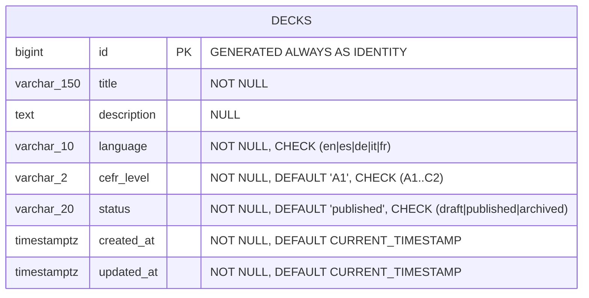

# Model relacyjny i diagram ERD — VocabHub (Lab 7)

## 1. Model relacyjny: tabela `decks`

Encja `decks` reprezentuje pojedynczą talię fiszek w aplikacji VocabHub

| Atrybut | Typ PostgreSQL | Reguła / Ograniczenie | Znaczenie |
| --- | --- | --- | --- |
| `id` | `BIGINT` | `GENERATED ALWAYS AS IDENTITY PRIMARY KEY` | Unikalny identyfikator talii nadawany automatycznie przez bazę |
| `title` | `VARCHAR(150)` | `NOT NULL` | Nazwa talii fiszek |
| `description` | `TEXT` | `NULL` | Opcjonalny dłuższy opis talii |
| `language` | `VARCHAR(10)` | `NOT NULL`, `CHECK (language IN ('en', 'es', 'de', 'it', 'fr'))` | Kod nauczanego języka |
| `cefr_level` | `VARCHAR(2)` | `NOT NULL DEFAULT 'A1'`, `CHECK (cefr_level IN ('A1', 'A2', 'B1', 'B2', 'C1', 'C2'))` | Poziom zaawansowania CEFR |
| `status` | `VARCHAR(20)` | `NOT NULL DEFAULT 'published'`, `CHECK (status IN ('draft', 'published', 'archived'))` | Etap publikacji talii |
| `created_at` | `TIMESTAMPTZ` | `NOT NULL DEFAULT CURRENT_TIMESTAMP` | Moment utworzenia rekordu |
| `updated_at` | `TIMESTAMPTZ` | `NOT NULL DEFAULT CURRENT_TIMESTAMP` | Moment ostatniej modyfikacji |

### Indeksy
- Klucz główny `id` tworzy indeks automatycznie.
- `decks_status_idx` (`status`) — przyspiesza filtrowanie po statusie.
- `decks_language_cefr_idx` (`language, cefr_level`) — przyspiesza filtrowanie katalogu po języku i poziomie CEFR.
- `decks_created_at_idx` (`created_at DESC`) — przyspiesza sortowanie od najnowszych talii.

## 2. Diagram ERD (etap 1-encyjny — Lab 7)

### Wersja ASCII

```text
┌────────────────────────────────────────────────────────┐
│                         DECKS                          │
├────────────────────────────────────────────────────────┤
│ PK  id           BIGINT        NOT NULL (IDENTITY)     │
│     title        VARCHAR(150)  NOT NULL                │
│     description  TEXT          NULL                    │
│     language     VARCHAR(10)   NOT NULL CHECK          │
│     cefr_level   VARCHAR(2)    NOT NULL DEFAULT 'A1'   │
│     status       VARCHAR(20)   NOT NULL DEFAULT 'pub.' │
│     created_at   TIMESTAMPTZ   NOT NULL                │
│     updated_at   TIMESTAMPTZ   NOT NULL                │
└────────────────────────────────────────────────────────┘
```

### Wersja Mermaid



## 3. Kierunek dalszej rozbudowy 

W kolejnych etapach projektu schemat zostanie rozszerzony bez łamania obecnej encji:
- **`users` → `decks` (`1:N`):** po dodaniu tabeli `users` tabela `decks` otrzyma klucz obcy `user_id` wskazujący właściciela talii.
- **`decks` → `cards` (`1:N`):** po dodaniu tabeli `cards`  każda fiszka będzie powiązana kluczem obcym `deck_id` z talią w `decks`.
